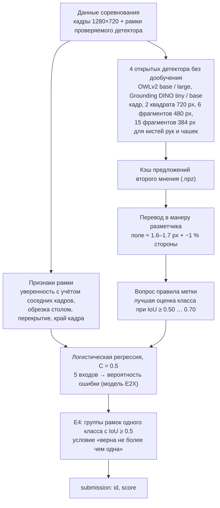

# RASCAR.HACK 2026 — Detector Error Discovery

**Команда «Эволюция»** · кейс 1 «Аудит детектора объектов» · соревнование Kaggle `rascar-hack-case-1`

**Итоговая модель — E4. Kaggle Public Average Precision: 0.95778.**
Результаты Private на момент публикации репозитория неизвестны и здесь не приводятся.

---

## 1. О проекте

Детектор объектов в кафе ставит рамки на людей, кисти рук, чашки и подносы. Часть рамок ошибочна, а у оператора мало
времени на проверку. Решение упорядочивает рамки детектора по **вероятности ошибки**: чем выше `score`, тем раньше
рамку стоит проверить.

Главная идея: метка `error` задаётся правилом «есть ли у рамки ручная рамка-пара с IoU ≥ 0.60». В тесте ручных рамок
нет, поэтому мы заменяем их **вторым мнением**: рамками четырёх открытых предобученных детекторов, переведёнными в
манеру разметчика. Затем задаём тот же вопрос, что и правило метки. E4 добавляет к этому второе свойство правила:
сопоставление взаимно однозначное, поэтому из двух сильно перекрывающихся рамок одного класса верной может быть
не больше одной.

Репозиторий содержит код, команды воспроизведения, автотесты, файлы отправки с контрольными суммами и отчёты.
Данные соревнования, веса открытых моделей и кэши их предсказаний в репозиторий **не входят**: как их получить,
описано в §7.

**Соответствие правилам.** Использованы только открытые предобученные модели без дообучения (названия и источники
весов — в §7.2). Ручной разметки теста нет, тестовые кадры обрабатывались только кодом. Ни один параметр не
подбирался по результатам Public: они служили только заранее объявленным вето при выборе файлов.

## 2. Постановка задачи

- **Единица оценки** — одна рамка проверяемого детектора. Для каждой строки `test.csv` сдаётся число `score` от 0
  до 1.
- **Метка `error`.** На каждом кадре рамки детектора и ручные рамки одного класса сопоставляются **взаимно
  однозначно** при IoU ≥ 0.60: сначала максимизируется число пар, затем суммарный IoU. Сопоставленная рамка получает
  `error = 0`, остальные `error = 1`. Ошибками считаются ложные срабатывания, ошибки класса, ошибки геометрии и дубли.
- **Метрика** — Average Precision по `error` (`sklearn.metrics.average_precision_score`), отдельно на частях Public и
  Private.
- **Оцениваемые классы:** `person`, `nude_hands`, `cup`, `tray`. Рамки столов организаторы исключили из оценки.

Наш код воспроизводит правило метки на всех 670 из 670 меток обучающей выборки (`tests/test_official_scoring_r6.py`,
`tests/test_data.py`; эти тесты требуют данных соревнования).

## 3. Данные и структура входных файлов

| | обучение, 25–26 октября 2026 | тест, 27–28 октября 2026 |
| --- | --- | --- |
| кадры | 84 размеченных, оцениваемые рамки на 35 из них | 128 целевых, рамки на 86 из них |
| оцениваемые рамки | 198 (109 ошибочных, 55 %) | 362 (метки неизвестны) |
| person / nude_hands / cup / tray | 84 / 63 / 33 / 18 | 153 / 131 / 54 / 24 |

Камера одна и неподвижна, кадр 1280 × 720, шаг около 30 секунд. Для каждого кадра доступны соседние кадры (±30 с) с
предсказаниями детектора и пул из 5 388 машинных кадров без разметки. По соглашению разметки рамка человека
охватывает его целиком, включая закрытые столом части тела.

Ожидаемое расположение файлов соревнования (таблицы и JPG-кадры лежат в одной папке, как в архиве Kaggle):

```text
data/raw/rascar-hack-case-1/
├── train.csv                     id, frame_id, class_name, confidence, x1, y1, x2, y2, error   (670 строк, включая столы)
├── test.csv                      id, frame_id, class_name, confidence, x1, y1, x2, y2          (362 строки)
├── sample_submission.csv         id, score
├── human_boxes_train.csv         ручные рамки обучающих кадров
├── train_frames.csv, test_frames.csv, train_context.csv, test_context.csv
├── train_stream_predictions.csv, test_stream_predictions.csv
├── machine_frames.csv, machine_predictions.csv, MACHINE_POOL.txt
├── TASK.txt, scoring_policy.json
└── *.jpg                         6 005 кадров
```

Другое расположение можно задать переменной `RASCAR_DATA_DIR` (её читает `src/rascar/paths.py`). Скрипты
`scripts/reproduce_*.py` читают `sample_submission.csv` из папки по умолчанию, поэтому для них проще оставить её.

## 4. Метод и архитектура E4



**Шаг 1. Второе мнение.** Четыре открытых детектора (`google/owlv2-base-patch16-ensemble`,
`google/owlv2-large-patch14-ensemble`, `IDEA-Research/grounding-dino-tiny`, `IDEA-Research/grounding-dino-base`)
работают с фиксированными текстовыми запросами без дообучения. Каждый смотрит кадр целиком, два квадрата 720 px
(левый и правый) и шесть фрагментов 480 px. Для кистей рук и чашек добавлены пятнадцать фрагментов 384 px. Рамки,
обрезанные внутренним краем своего фрагмента, отбрасываются.

**Шаг 2. Перевод в манеру разметчика.** Открытые детекторы обводят объект вплотную, а разметчик оставляет поле. По
ручным рамкам обучающих кадров измерено, что ручная рамка шире с каждой стороны на 1.63 px + 1.0 % ширины и на
1.73 px + 0.9 % высоты. Это поле (4 числа, одинаковые для всех классов) добавляется к рамкам второго мнения.

**Шаг 3. Вопрос правила метки.** Для проверяемой рамки и каждого детектора берётся лучшая оценка класса среди рамок
второго мнения, которые совпадают с ней не хуже порога IoU. Порогов пять (0.50; 0.55; 0.60; 0.65; 0.70), результат
по ним усредняется. Четыре значения (по одному на детектор) нормируются внутри класса и усредняются. Получается вход
«согласие со вторым мнением».

**Шаг 4. Модель E2X.** Логистическая регрессия на пяти входах (§5). Её выход — вероятность ошибки `p`.

**Шаг 5. E4: правило «один объект — одна рамка».** Рамки одного класса на одном кадре с IoU ≥ 0.5 образуют группы
(компоненты связности). Внутри группы вероятности E2X `p_i` пересчитываются при условии «верна не более чем одна
рамка группы»:

```text
Z     = ∏_j p_j + Σ_i (1 − p_i) · ∏_{j≠i} p_j
p_i'  = 1 − (1 − p_i) · ∏_{j≠i} p_j / Z

для пары:  p_A' = p_A / (1 − (1 − p_A)(1 − p_B))      пример: (0.07, 0.50) → (0.13, 0.93)
```

На E4 ничего не обучается: модель E2X используется без изменений, а оценки рамок вне групп совпадают с E2X бит в бит.
Все оценки внутри группы растут, порядок рамок внутри группы сохраняется. В тесте меняются 50 оценок из 362
(24 группы: 32 рамки кистей рук, 16 чашек, 2 человека). Порог 0.5 выбран после просмотра пар рамок на размеченных днях.
Там среди 19 пар рамок одного класса с IoU ≥ 0.5 нет ни одной, где верны обе.

**Важно:** оценка рамки в E4 зависит от других рамок того же кадра. Поэтому кадры подаются **целиком**: все 362
строки теста оцениваются вместе.

### Конфигурация E4

Параметры заданы в коде, отдельного файла конфигурации нет:

| параметр | значение | где задан |
| --- | --- | --- |
| базовая модель | E2X, `e2x_pixel_inner_hires` | `src/rascar/emulation2.py`, `E2X = Config(...)` |
| мелкие фрагменты 384 px | `nude_hands`, `cup` | `Config.hires_classes` |
| отбрасывание обрезанных краем фрагмента рамок | да | `Config.drop_border = True` |
| поле разметчика | в пикселях, без деления на классы | `Config.margin = "pixel"` |
| пороги IoU в вопросе правила метки | 0.50, 0.55, 0.60, 0.65, 0.70 | `src/rascar/emulation.py`, `THRESHOLDS` |
| регуляризация регрессии | C = 0.5 | `src/rascar/final_models.py`, `C_REG` |
| сжатие классовых статистик | псевдосчёт 10 | `src/rascar/final_models.py`, `PSEUDO_COUNT` |
| порог группы E4 | IoU ≥ 0.5 | `src/rascar/emulation4.py`, `TAU` |
| параметры E4, подбираемые оптимизацией | 0 | — |

## 5. Feature Engineering

Входы логистической регрессии (`src/rascar/emulation2.py`, метод `EmulationModel2._design`). Предобработка:
медианное заполнение пропусков, затем `StandardScaler`, затем `LogisticRegression(C=0.5)`.

| № | вход | смысл | коэффициент в итоговой модели* |
| ---: | --- | --- | ---: |
| 1 | `tc_logit` | уверенность детектора с учётом соседних кадров (±30 с) | −0.895 |
| 2 | согласие со вторым мнением | среднее по 4 детекторам z-оценок (внутри класса) «вопроса правила метки», §4, шаг 3 | −2.150 |
| 3 | `p_tb_cut0` | рамка человека обрезана столом | +0.289 |
| 4 | `f_cov_same` | доля рамки, закрытая другой рамкой того же класса | +0.431 |
| 5 | `edge_rel` | положение относительно края кадра (ограничено диапазоном 0…12) | +0.307 |

\* Коэффициенты модели, обученной на всех 198 размеченных рамках (на стандартизованных входах). Свободный член
0.536. Источник: отчёт о воспроизведении E4 в рабочей копии команды от 14 ноября 2026.

Входы 1, 3, 4 и 5 строит `rascar.train` (`features.py`, `temporal.py`, `geometry.py`) и сохраняет в таблицу признаков
`results/frozen_v3b/`. Вход 2 строит `rascar.emulation2` из кэша второго мнения. Обучаемые величины (поле
разметчика, классовые статистики, регрессия) при проверке «день на день» берутся только из обучающего дня.

## 6. Установка и зависимости

Проверено на Windows 11 и Python 3.14.7. Точные версии всех пакетов перечислены в `requirements.txt`.

```powershell
python -m venv .venv
.\.venv\Scripts\pip install -r requirements.txt
.\.venv\Scripts\pip install -e .
```

Пакет `rascar` нужно установить (`pip install -e .`), потому что скрипты кэша и таблицы признаков импортируют его
напрямую. На Linux и macOS используйте `.venv/bin/python` и прямые слэши в путях; на этих системах проект не
проверялся.

| компонент | версия |
| --- | --- |
| Python | 3.14.7 |
| numpy / pandas / scipy | 2.5.4 / 3.1.1 / 1.18.1 |
| scikit-learn / joblib | 1.9.1 / 1.6.0 |
| torch / transformers / pillow | 2.15.0 / 5.22.2 / 13.0.0 (только для построения кэша) |
| pytest | 9.2.0 |

Для расчёта E4 по готовому кэшу хватает CPU. Кэш второго мнения строится на GPU. У команды для этого было отдельное
окружение `.venv_gpu`: CUDA-сборка PyTorch (torch 2.14.1+cu126), `transformers` и установленный пакет `rascar`, а
видеокарта — NVIDIA RTX 3050 4 ГБ.

## 7. Подготовка данных и весов

### 7.1. Данные соревнования

Скачайте данные со страницы соревнования Kaggle `rascar-hack-case-1` (нужно принять правила соревнования) и
распакуйте в `data/raw/rascar-hack-case-1/` (§3). Правила не разрешают распространять данные, поэтому их нет в
репозитории.

### 7.2. Веса открытых моделей

| модель | источник | лицензия по карточке модели |
| --- | --- | --- |
| OWLv2 base | <https://huggingface.co/google/owlv2-base-patch16-ensemble> | Apache-2.0 |
| OWLv2 large | <https://huggingface.co/google/owlv2-large-patch14-ensemble> | Apache-2.0 |
| Grounding DINO tiny | <https://huggingface.co/IDEA-Research/grounding-dino-tiny> | Apache-2.0 |
| Grounding DINO base | <https://huggingface.co/IDEA-Research/grounding-dino-base> | Apache-2.0 |

Веса в репозиторий не входят. Лицензии команда сверила по карточкам моделей 13 ноября 2026. При первом запуске
команд §7.3 веса скачиваются через `from_pretrained` в `models/hf_cache` (код сам задаёт `HF_HOME`). Скрипт
`g01_cache_gpu.py` работает офлайн (`HF_HUB_OFFLINE=1`), поэтому запускайте его последним, когда все четыре модели
уже скачаны.

### 7.3. Кэш второго мнения (GPU, несколько часов)

Детекторы запускаются по одному. Команды повторяют те, которыми команда строила кэш:

```powershell
# девять видов кадра: кадр целиком, два квадрата 720 px, шесть фрагментов 480 px -> data/interim/vision/
.\.venv\Scripts\python.exe -I -m rascar.vision --parts "train,test"                     # OWLv2 base, три вида
.\.venv\Scripts\python.exe -I -m rascar.vision --parts "train,test" --fine              # OWLv2 base, шесть фрагментов
.\.venv\Scripts\python.exe -I -m rascar.vision_gdino --parts "train,test" --mode base   # Grounding DINO tiny
.\.venv\Scripts\python.exe -I -m rascar.vision_gdino --parts "train,test" --mode fine
.\.venv_gpu\Scripts\python.exe -I research\lead\g1_detectors_gpu.py --model gdinob      # Grounding DINO base
.\.venv_gpu\Scripts\python.exe -I research\lead\g1_detectors_gpu.py --model owlL        # OWLv2 large

# пятнадцать фрагментов 384 px -> results/final_breakthrough/agent_G/cache/<model>_hires/
.\.venv_gpu\Scripts\python.exe -I -X utf8 research\final_breakthrough\agent_G\g01_cache_gpu.py --model gdinob --views hires
.\.venv_gpu\Scripts\python.exe -I -X utf8 research\final_breakthrough\agent_G\g01_cache_gpu.py --model gdino  --views hires
.\.venv_gpu\Scripts\python.exe -I -X utf8 research\final_breakthrough\agent_G\g01_cache_gpu.py --model owlL   --views hires
.\.venv_gpu\Scripts\python.exe -I -X utf8 research\final_breakthrough\agent_G\g01_cache_gpu.py --model owlv2  --views hires
```

В рабочей копии команды кэш `data/interim/vision/` занимает около 635 МБ. Grounding DINO base на пятнадцати фрагментах
384 px обрабатывает один кадр примерно за 8.4 с на RTX 3050 (пик 1.7 ГБ видеопамяти).

### 7.4. Таблица признаков `results/frozen_v3b/`

Скрипты `reproduce_*.py` читают таблицу признаков `results/frozen_v3b/features_{train,test}.csv`. Она получена из
данных соревнования (в обучающей части есть метка `error`), поэтому в репозиторий не входит. Таблица строится из
данных и кэша:

```powershell
$env:FROZEN_TAG = "frozen_v3b"
.\.venv\Scripts\python.exe -I -X utf8 research\lead\v3_export_frozen.py
```

Для сверки: SHA-256 таблиц в рабочей копии команды — `features_train.csv` `2f9098c666aebb0ecd852c1bca7312d2a9929f8ece1390bc0f47bfc759c8433c`,
`features_test.csv` `dfed2f1f1028927920b0429fdcb560abc03d087e4ab4200cdb6ddcc29a5bd2bf`. Скрипт также читает два ранних
загруженных файла из `submissions/kaggle_submitted/` (они есть в репозитории) и добавляет их оценки как справочные
столбцы. Модели эти столбцы не используют.

## 8. Запуск inference

Одна команда (CPU) обучает E2X, проверяет её «день на день», считает E4 для 362 рамок теста, пишет файл отправки и
сравнивает его с поставленным:

```powershell
.\.venv\Scripts\python.exe -I -X utf8 -B scripts\reproduce_e4.py --rebuild-features --out results\repro_e4 --compare submissions\EVOLYUTSIYA_CASE1_E4_OPTIONAL.csv
```

Что происходит внутри:

1. `--rebuild-features`: признаки пересчитываются из сырых таблиц и кэша и сравниваются с `results/frozen_v3b`
   (в отчёте поле `feature_rebuild_ok`). Без этого флага используются входы из `results/frozen_v3b`.
2. Проверка «день на день» для E2X и E4 (в отчёте `lodo_ap`, `lodo_ap_e2x`).
3. Обучение E2X на всех 198 размеченных рамках, сохранение в `<out>/models/`, повторная загрузка.
4. Предсказание E2X для теста, затем пересчёт E4 внутри групп.
5. Запись CSV и сравнение: с поставленным файлом E2X (`base_scores_vs_delivered_e2x_max_abs_diff`) и с файлом из
   `--compare` (`byte_identical`).

Результаты в `<out>`: `e4_e2x_one_to_one.csv` (файл отправки), `e4_e2x_one_to_one_test_detail.csv` (оценки E2X и E4
для каждой строки теста и признак группы), `e4_e2x_one_to_one_oof.csv` (оценки «день на день»), `models/`,
`REPRO_REPORT.json`. Скрипт отказывается писать в `submissions/`. В рабочей копии команды запуск занял 75–101 с.

Остальные модели воспроизводятся так же:

```powershell
.\.venv\Scripts\python.exe -I -X utf8 -B scripts\reproduce_e2.py --rebuild-features --config e2x_pixel_inner_hires --out results\repro_e2x --compare submissions\EVOLYUTSIYA_CASE1_E2X_OPTIONAL.csv
.\.venv\Scripts\python.exe -I -X utf8 -B scripts\reproduce_e2.py --rebuild-features --out results\repro_e2 --compare submissions\EVOLYUTSIYA_CASE1_E2_CANDIDATE.csv
.\.venv\Scripts\python.exe -I -X utf8 -B scripts\reproduce_breakthrough.py --rebuild-features --out results\repro_e1 --compare submissions\EVOLYUTSIYA_CASE1_E1_CANDIDATE.csv
```

## 9. Генерация submission.csv

`scripts/reproduce_e4.py` записывает `<out>/e4_e2x_one_to_one.csv` функцией `rascar.final_models.write_submission`.
Формат: заголовок `id,score`, 362 строки в порядке `sample_submission.csv`, 10 знаков после точки, переводы строк LF.
Функция не запишет файл, если набор `id` не совпадает с `sample_submission.csv` или оценка выходит за [0, 1].

```powershell
Copy-Item results\repro_e4\e4_e2x_one_to_one.csv submission.csv
Get-FileHash submission.csv -Algorithm SHA256     # E4: 7F4C2569B820B899A4A9DD7621EB662369D2C50BEF5E0A9137954667EC9C210A
```

Проверка схемы любого файла отправки встроенным валидатором (`rascar.submission.validate`; нужен
`sample_submission.csv` из данных соревнования):

```powershell
.\.venv\Scripts\python.exe -I -c "import pandas as pd; from rascar import data, submission as s; print(s.validate(pd.read_csv(r'submissions/EVOLYUTSIYA_CASE1_E4_OPTIONAL.csv', dtype={'id': str}), data.load_sample_submission()))"
```

Валидатор проверяет столбцы `id,score`, число строк, уникальность и полноту `id`, числовые конечные оценки в [0, 1]
и то, что оценки не постоянны.

## 10. Локальная валидация

**Основной протокол — строгий «день на день»**, его рекомендует условие задачи. Модель обучается на одном размеченном
дне и проверяется на другом, затем дни меняются местами. Поле разметчика, классовые статистики и регрессия
берутся только из обучающего дня. Итоговое число — среднее AP двух дней.

| | 25 окт. | 26 окт. | среднее |
| --- | ---: | ---: | ---: |
| E2X | 0.98662 | 0.95378 | 0.97020 |
| **E4** | **0.98662** | **0.96187** | **0.97424** |

Устойчивость разницы E4 − E2X (источник: `submissions/E4_OPTIONAL_MANIFEST.json`):

| проверка | E4 − E2X |
| --- | --- |
| «день на день», среднее AP двух дней | +0.0040 (25 окт. 0.0000, 26 окт. +0.0081) |
| исключение по одному кадру | +0.0034 (среднее по дням), +0.0043 (объединённая AP) |
| 5 частей по группам кадров, 100 повторов | +0.0035, выше E2X во всех 100 повторах (это устойчивость на тех же 198 строках, а не значимость) |
| бутстреп по кадрам с переобучением, 300 повторов | P(Δ > 0) = 0.957, 95 %-й интервал −0.0005 … +0.0147 |
| плацебо: то же преобразование на случайных неперекрывающихся парах | −0.0144 (положительно в 0 из 3 000 случаев) |

Локально прирост E4 мал и сосредоточен в немногих группах. Одна группа из четырёх подносов на кадре 26 октября даёт
73 % прироста, две группы дают 94 %. Без групп подносов остаётся +0.0009 … +0.0012, а в тесте групп подносов нет.
Вариант E4 был третьим вариантом идеи и сформулирован после отказа от жёсткого правила, то есть post hoc. Поэтому
до загрузки на Kaggle мы не называли E4 доказанным улучшением.

Дополнительно команда проверяла модели разбиениями по группам кадров, исключением по одному кадру, парным
бутстрепом, сценариями с другой долей ошибок и плацебо-контролями. Гипотеза, способ проверки и условие отказа
записывались до эксперимента. Подробно: `docs/VALIDATION_AND_GENERALIZATION.md`, `docs/MODEL_COMPARISON.md`.

## 11. Экспериментальные результаты

Локальные числа — строгий «день на день». Kaggle Public — одно число на файл с лидерборда соревнования.

| модель | что изменилось | 25 окт. | 26 окт. | среднее | Kaggle Public AP |
| --- | --- | ---: | ---: | ---: | ---: |
| базовая сортировка «1 − уверенность» | — | 0.8607 | 0.7648 | 0.8128 | не загружалась |
| 03 | согласие четырёх детекторов: оценка × IoU | 0.9775 | 0.9316 | 0.9545 | 0.89976 |
| E1 | поле разметчика + вопрос правила метки | 0.9846 | 0.9462 | 0.9654 | 0.92964 |
| E2 | E1 + мелкие фрагменты для кистей рук и чашек | 0.9854 | 0.9479 | 0.9666 | 0.93571 |
| E2X | E2 + отбрасывание обрезанных рамок + поле в пикселях | 0.9866 | 0.9538 | 0.9702 | 0.93284 |
| E3 | E2X без входов `f_cov_same` и `edge_rel` | 0.9915 | 0.9547 | 0.9731 | 0.89516 (отвергнута вето) |
| **E4** | **E2X + правило «один объект — одна рамка»** | **0.9866** | **0.9619** | **0.9742** | **0.95778** |

Ранние загрузки 12–13 ноября: смесь моделей `vf_blend_geo_gbm` — 0.71980, `c9_lr_geo` — 0.80490, `r4b_o5c_classrank` —
0.81456, `r4a_clsstd_all` — 0.89326.

Что показывают результаты:

- **E4 — лучший результат команды на Public: 0.95778**, на 0.02494 выше E2X и на 0.02207 выше E2.
- **Шаг 03 → E1** — единственный большой шаг, подтверждённый и локально (+0.011), и на Public (+0.030). Открытые
  детекторы начинают «отвечать на вопрос метки» только после перевода их рамок в манеру разметчика.
- **Локальная проверка различает разницу примерно от 0.02.** На 198 строках порядок малых приростов на Public может
  быть другим. E3 была локально выше E2X на 0.003, а на Public потеряла 0.038. E2 на Public выше E2X, хотя локально
  ниже. E4 на Public выросла сильнее, чем локально.
- Public — одна часть теста и одно число на файл. Это наблюдение, а не доказательство превосходства на Private.
- Очередь проверки E2X на размеченных днях: в верхних 30 % очереди все рамки ошибочны (у базовой сортировки 81 %).
  Чтобы найти 90 % ошибок, хватает 52 % очереди (у базовой сортировки 69 %). Это измерено на 198 рамках двух дней и
  не является оценкой экономии времени оператора.

Анализ ошибок, отвергнутые гипотезы (дообученный детектор-«разметчик», SAM и ключевые точки, слияние рамок,
усреднение по соседним кадрам, смеси моделей и другие) и их измерения: `docs/FINAL_TECHNICAL_REPORT_RU.md`, §6–§7, и
`docs/MODEL_COMPARISON.md`, §4.

## 12. Воспроизводимость

**Проверено в рабочей копии команды (14 ноября 2026, полные данные и кэш):**

- файл E4 пересоздан из сырых таблиц и кэша **байт-в-байт** (SHA-256 `7f4c2569…c210a`) четырьмя запусками, один
  из них сделал независимый внутренний проверяющий. В последнем запуске `feature_rebuild_ok: true`,
  `byte_identical: true`, 101 с на CPU;
- файлы E2X и E1 пересозданы байт-в-байт тем же способом;
- полный набор автотестов: 204 из 204 пройдено.

**Проверено в этом репозитории (15 ноября 2026, без данных соревнования):**

- все файлы Python компилируются, пакет `rascar` импортируется из `src/`;
- автотесты: **174 passed, 30 skipped** (139 с). Пропущены тесты, которым нужны данные соревнования или таблица
  признаков: в репозитории их нет;
- SHA-256 четырёх файлов отправки совпадают с их файлами `.sha256` и манифестами, файл E4 проходит валидатор схемы;
- код E4 (`emulation.py`, `emulation2.py`, `emulation4.py`, `final_models.py`, `scripts/reproduce_e4.py`,
  `tests/test_emulation4.py`) совпадает по SHA-256 с хешами в `submissions/E4_OPTIONAL_MANIFEST.json`.

**Не проверено в этом репозитории (NOT VERIFIED):** полный прогон §7–§9 с нуля, то есть скачивание данных и весов,
построение кэша и таблицы признаков и пересоздание E4. Для этого нужны данные соревнования и GPU.

**Переносимость.** Пути в пакете относительные: корень проекта определяется по `pyproject.toml` или переменной
`RASCAR_ROOT`, папка данных — переменной `RASCAR_DATA_DIR` (`src/rascar/paths.py`). Единственное изменение кода
относительно рабочей копии сделано в `research/final_breakthrough/agent_G/g01_cache_gpu.py`: жёстко заданный локальный
путь к проекту заменён на `RASCAR_ROOT` или папку на три уровня выше файла.

Автотесты:

```powershell
.\.venv\Scripts\python.exe -I -X utf8 -B -m pytest -q -p no:cacheprovider tests
```

## 13. Структура репозитория

```text
RASCAR-HACK-2026/
├── README.md
├── pyproject.toml                  пакет rascar (pip install -e .)
├── requirements.txt                точные версии проверенного окружения
├── src/rascar/
│   ├── emulation4.py               E4: условие «верна не более чем одна рамка группы»
│   ├── emulation2.py               E2 / E2X: виды кадра, поле разметчика в пикселях, регрессия
│   ├── emulation.py                E1: второе мнение, поле разметчика, ручные рамки, вопрос правила метки
│   ├── emulation3.py               E3 (отвергнутый вариант, сохранён для полноты)
│   ├── final_models.py             модели 03/05, классовые статистики, запись файла отправки
│   ├── train.py, features.py, temporal.py, geometry.py, extent.py   таблица признаков рамки
│   ├── vision.py, vision_gdino.py, vision_zoom.py                   запуск открытых детекторов, кэш
│   ├── data.py, paths.py, metrics.py, validation.py, submission.py  данные, пути, метрика, проверка, схема отправки
│   └── models.py, predict.py, audit.py                              ранние модели и аудит данных
├── scripts/
│   ├── reproduce_e4.py             E4 одной командой
│   ├── reproduce_e2.py             E2 и E2X
│   ├── reproduce_breakthrough.py   E1
│   ├── reproduce_final.py          пересборка признаков (нужна для --rebuild-features); модели 03/05
│   └── accept_test.py              заранее зарегистрированное правило приёмки моделей (используется тестами)
├── research/
│   ├── lead/g1_detectors_gpu.py                       кэш Grounding DINO base и OWLv2 large (GPU)
│   ├── lead/g2_consensus_eval.py                      «мнения» детекторов для таблицы признаков
│   ├── lead/v3_export_frozen.py                       таблица признаков results/frozen_v3b
│   └── final_breakthrough/agent_G/g01_cache_gpu.py    фрагменты 384 px (GPU)
├── tests/                          автотесты pytest (19 файлов)
├── docs/
│   ├── FINAL_TECHNICAL_REPORT_RU.md        технический отчёт (состояние на 14.11.2026)
│   ├── MODEL_COMPARISON.md                 сравнение моделей по одному протоколу
│   └── VALIDATION_AND_GENERALIZATION.md    что проверка может и чего не может сказать о Private
└── submissions/
    ├── README.md                   файлы отправки, SHA-256, результаты Public
    ├── EVOLYUTSIYA_CASE1_E4_OPTIONAL.csv    + .sha256 + E4_OPTIONAL_MANIFEST.json    итоговая модель E4
    ├── EVOLYUTSIYA_CASE1_E2_CANDIDATE.csv   + .sha256 + E2_CANDIDATE_MANIFEST.json
    ├── EVOLYUTSIYA_CASE1_E2X_OPTIONAL.csv   + .sha256 + E2X_OPTIONAL_MANIFEST.json   (база E4)
    ├── EVOLYUTSIYA_CASE1_E1_CANDIDATE.csv   + .sha256 + E1_CANDIDATE_MANIFEST.json
    └── kaggle_submitted/           два ранних загруженных файла (входы v3_export_frozen.py)
```

Создаются при запуске и игнорируются git: `data/`, `models/`, `results/`.

| не входит в репозиторий | почему | как получить |
| --- | --- | --- |
| данные соревнования (`data/raw/`, 6 005 JPG) | правила запрещают распространение | Kaggle, §7.1 |
| веса четырёх открытых детекторов (`models/hf_cache/`) | сторонние веса | Hugging Face, §7.2 |
| кэш второго мнения (`data/interim/vision/`, `results/final_breakthrough/agent_G/cache/`) | получен из кадров соревнования, сотни мегабайт | §7.3 |
| таблица признаков `results/frozen_v3b/` | получена из данных соревнования и содержит метки | §7.4 |
| демонстрационная страница очереди проверки | содержит фрагменты кадров соревнования | — |
| журналы исследований, контрольные точки, рабочие заметки | для запуска E4 не нужны | — |

## 14. Ограничения

- **Мало размеченных данных:** 198 рамок за два дня. Локальная проверка надёжно различает разницу примерно от 0.02,
  поэтому малые локальные приросты, в том числе +0.0040 у E4, мы не называем доказанными. Вариантов на этих строках
  за всё время оценено много, и это повышает риск случайно удачного выбора.
- **E4 сформулирована post hoc,** а её порог 0.5 выбран после просмотра пар рамок на размеченных днях. Локальный
  прирост держится на немногих группах. Пересчёт полезен, только если вероятности E2X достаточно «резкие»: при их
  сглаживании (логит × 0.25) он вредит (−0.0117).
- **E4 оценивает кадр целиком:** оценка рамки зависит от других рамок того же кадра, поэтому построчная обработка
  без полного кадра даст другой результат.
- **Public и Private:** Public — одна часть теста, одно число на файл. Private на момент публикации неизвестен.
  Локальная AP выше Public. Часть разницы объясняется свойством метрики (оценка без меток: в тесте около 49 %
  ошибочных рамок против 55 % на размеченных днях), остальное не объяснено.
- **Обобщение:** одна камера и одна группа разметчиков. Для другой камеры поле разметчика нужно измерить заново,
  а новые классы требуют новых текстовых запросов к открытым детекторам.
- **Затраты:** расчёту нужен кэш четырёх детекторов, построенный на GPU (несколько часов для этого набора).
  Потоковый режим не реализован и не измерялся.
- **Остаток ошибок:** «объекта нет» почти полностью наверху очереди. Остаются рамки рядом с порогом IoU 0.60 и люди,
  частично закрытые столом. Здесь открытые детекторы повторяют ручную рамку с точностью 6–10 % стороны, а нужно
  около 3 %.

## 15. Команда и роли

| участник | роль |
| --- | --- |
| Нодир Одилов | капитан команды, технический лидер: данные, модели, код, валидация, файлы отправки |
| Вячеслав Поляков | презентация и защита решения |
